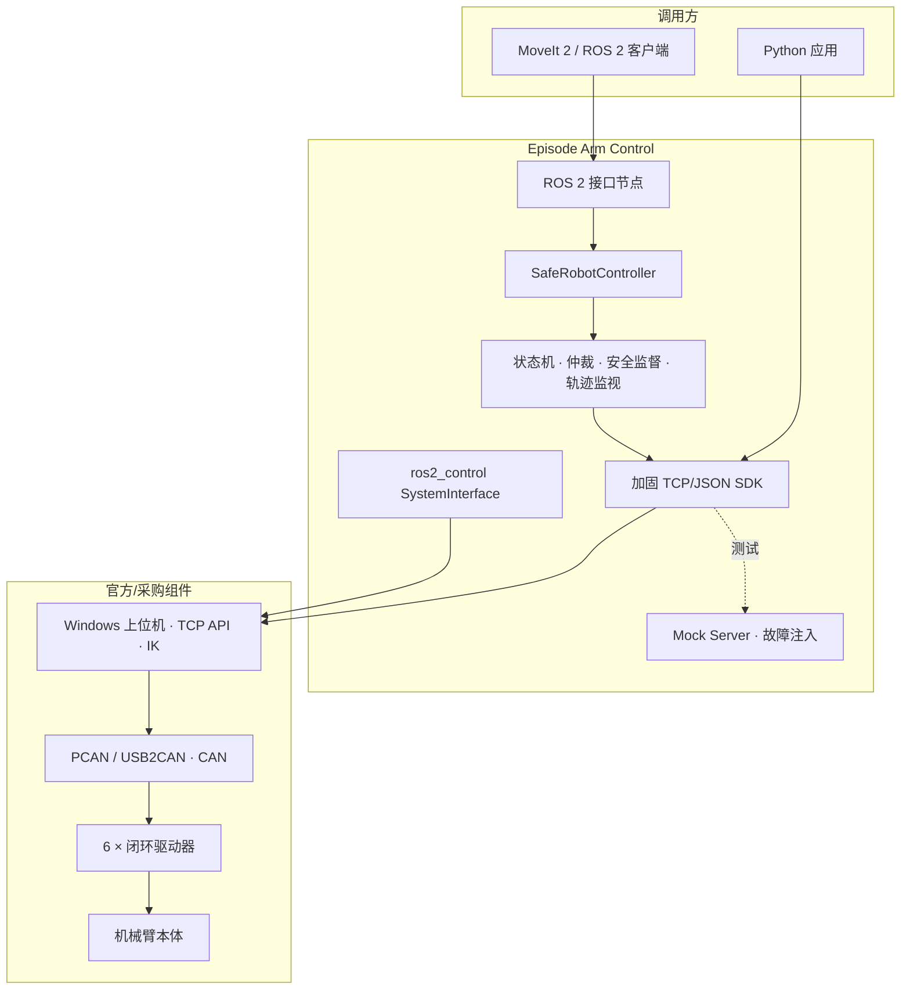

# Episode Arm Control

[](https://github.com/LJS515/episode-arm-control/actions/workflows/ci.yml)
[](https://www.python.org/)
[](https://docs.ros.org/en/jazzy/)
[](LICENSE)

面向恩培 Episode 1 六轴机械臂的安全控制与轨迹执行系统。项目在官方 TCP/JSON 控制链之上提供可靠通信、状态机、命令仲裁、状态缓存、安全监督、轨迹到位判定、ROS 2 接口、`ros2_control` 硬件插件和 MoveIt 配置。

> 当前软件栈已在 Mock 环境和 ROS 2 Jazzy（WSL2 Ubuntu 24.04）中验证，尚未在真实机械臂上完成联调。所有 Mock 结果均为合成数据，不能替代真机安全测试。

## 核心能力

- 加固 TCP/JSON SDK：完整帧读取、绝对超时、帧大小限制、UTF-8/JSON/NaN 校验、幂等重试。
- 安全控制层：显式状态机、单一运动所有权、反馈新鲜度检查、故障锁存和急停旁路。
- 轨迹执行：基于实测关节反馈、容差和稳定时间判断到位，不把服务器返回的预计耗时当作完成信号。
- ROS 2：`FollowJointTrajectory`、关节状态、诊断、急停/回零/故障恢复服务。
- `ros2_control`：支持 Mock 与官方 TCP 上位机后端的 `SystemInterface`。
- MoveIt：提供 Mock 模型和官方模型接入配置；官方 URDF/STL 需由用户自行下载。
- 可测试性：协议异常、并发、安全状态、轨迹、故障注入和 ROS 节点逻辑均有自动化覆盖。

## 架构



## 快速开始

需要 Python 3.10 或更高版本。

```bash
git clone https://github.com/LJS515/episode-arm-control.git
cd episode-arm-control
python -m venv .venv
# Linux/macOS: source .venv/bin/activate
# Windows: .venv\Scripts\activate
pip install -r requirements-dev.txt
python examples/mock_demo.py
```

示例默认使用 Mock，不会连接真实硬件：

```bash
python examples/read_angles.py
python examples/move_joints_safe.py
python examples/move_pose_safe.py
python -m episode_sdk.mock_server --port 12345
```

## 测试与质量检查

```bash
python -m pytest -q
python tools/validate_configuration.py
python tools/generate_mock_report.py --out reports/mock_fault_injection_report.md
```

持续集成会在 Python 3.10、3.11 和 3.12 上运行测试与配置校验。ROS 2、`ros2_control` 和 MoveIt 的目标环境验证步骤见 [ROS 2 运行报告](reports/ros2_runtime_wsl.md)。

## ROS 2 Jazzy

```bash
source /opt/ros/jazzy/setup.bash
python3 -m venv --system-site-packages ~/episode_ws/venv
source ~/episode_ws/venv/bin/activate
pip install -e /path/to/episode-arm-control

mkdir -p ~/episode_ws/src
cd ~/episode_ws/src
ln -s /path/to/episode-arm-control/episode_ros2 .
ln -s /path/to/episode-arm-control/ros2_control episode_ros2_control
ln -s /path/to/episode-arm-control/moveit_config episode_moveit_config

cd ~/episode_ws
python -m colcon build --symlink-install
source install/setup.bash
ros2 launch episode_ros2 mock.launch.py
```

另开终端执行冒烟测试：

```bash
python3 /path/to/episode-arm-control/episode_ros2/test/ros2_runtime_smoke.py
```

`ros2_control` 与 MoveIt 的详细命令分别见 [ros2_control/README.md](ros2_control/README.md) 和 [moveit_config/README.md](moveit_config/README.md)。

## 连接真实机械臂

真实硬件操作前必须满足以下条件：

1. 硬件急停或断电开关在操作员触手可及处，并完成过断电演练。
2. 官方上位机完成回零，机械臂姿态和驱动固件版本已核对。
3. TCP 服务仅绑定受信网络；当前协议没有认证和加密。
4. 先只读验证，再逐关节核对坐标方向、软限位和速度上限。
5. 真机启动必须显式传入 `--real-robot` 或 `confirm_real_robot:=true`。

```bash
python examples/read_angles.py --host 127.0.0.1 --real-robot
ros2 launch episode_ros2 hardware.launch.py host:=127.0.0.1 confirm_real_robot:=true
```

完整要求见 [安全架构](docs/12_safety_architecture.md) 和 [安全策略](SECURITY.md)。

## 项目边界

机械结构、电机、闭环驱动器、固件、官方上位机、IK、官方 ROS 2 包和模型资源均为第三方组件，不属于本仓库。本仓库只包含自主实现的互操作层、安全控制、测试、配置和技术文档，不分发官方二进制文件、动态库、固件或模型资源。

## 已知限制

- 尚无真机延迟、精度、急停时间和轨迹误差数据。
- Python `FollowJointTrajectory` 当前按路点进行点到点执行，不严格遵守 `time_from_start`。
- `ros2_control` 的流式位置接口与官方点到点 TCP API 存在语义差异。
- 电机侧编码器无法检测 J5 皮带之后的输出侧误差。

更多信息见 [KNOWN_LIMITATIONS.md](KNOWN_LIMITATIONS.md) 和 [未来路线图](docs/21_future_roadmap.md)。

## 目录结构

```text
episode_sdk/        TCP/JSON SDK 与 Mock Server
episode_hardware/   状态机、仲裁、缓存、安全监督、轨迹监视与运动学
episode_ros2/       ROS 2 Python 包
ros2_control/       C++ SystemInterface
moveit_config/      MoveIt 2 配置
config/             运行参数与安全限制
tests/              Python 自动化测试
tools/              抓包、分析、报告和配置校验工具
examples/           Mock 默认的使用示例
docs/               架构、协议、安全、测试与集成文档
reports/            可复现的 Mock 与环境验证报告
```

## 许可

本仓库自主实现的代码与文档采用 [MIT License](LICENSE)。第三方组件仍受其各自许可约束。
