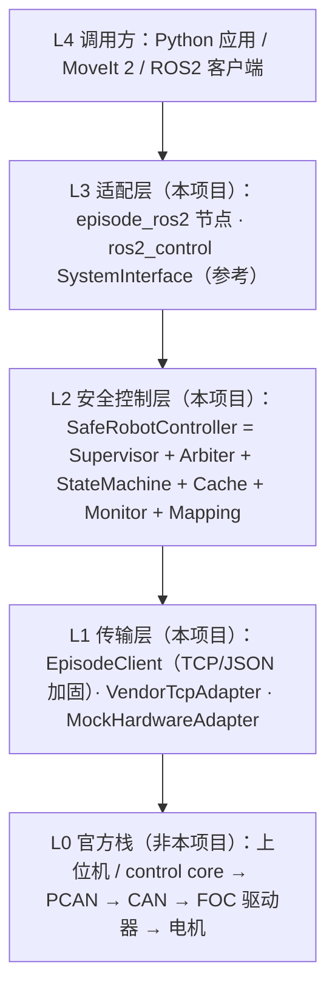

# 01 系统架构

> 状态：设计 + 实现（Python 层，Mock 验证）。图源：`diagrams/system_architecture.mmd`。

## 分层

## 关键设计原则

1. **不碰 CAN、不碰 FOC。** 总线由官方进程独占（路线 A 的上位机或路线 B 的 control core）。本项目所有硬件访问都经过官方接口。原因：驱动器帧格式、波特率、ID 未公开（证据缺失），自行发帧既不可验证也可能与官方进程抢总线。
2. **纯 Python 核心与 ROS 解耦。** `episode_sdk`、`episode_hardware` 不 import ROS，可在 Windows/无 ROS 环境下全量测试；ROS 节点只做适配。
3. **单一硬件锁。** `SafeRobotController.hardware_lock` 保证同一时刻只有一个总线事务；只有急停绕过它。
4. **反馈驱动完成判定。** 命令回执只代表“已接受 + 预计耗时”；到位由 `TrajectoryMonitor` 依据实测反馈判断。
5. **故障锁存、受控清除。** 任何故障进入 FAULT 后不会自动恢复；需操作员确认 + 条件满足，且回到 INACTIVE 而不是 READY。
6. **证据分级。** 所有关于硬件/官方软件的陈述带 A–E 等级；无实测的数字一律 `TBD`。

## 模块对照

| 模块 | 文件 | 职责 | 验证 |
|---|---|---|---|
| 协议 | `episode_sdk/protocol.py` | 帧编解码、`recv_exact`、截止时间 | test_protocol（socketpair） |
| 客户端 | `episode_sdk/client.py` | API、超时、兼容模式、重试策略、专用急停连接 | test_client（Mock TCP） |
| Mock Server | `episode_sdk/mock_server.py` | 模拟官方服务器 + 故障注入 | 被所有 TCP 测试使用 |
| 映射/运动学 | `joint_mapping.py`, `kinematics.py` | 电机角↔模型角，参考 FK/IK | test_joint_mapping |
| 状态缓存 | `state_cache.py` | 时间戳、age、失败计数 | test_state_cache |
| 状态机 | `state_machine.py` | 8 状态、守卫、钩子、历史 | test_state_machine |
| 仲裁器 | `command_arbiter.py` | 单一所有权、排队/抢占/拒绝、急停 | test_command_arbiter |
| 安全监督 | `safety_supervisor.py` | 运动前/中/后检查、故障锁存 | test_safety_supervisor |
| 轨迹监视 | `trajectory_monitor.py` | desired/actual/error、超时、终点误差 | test_trajectory_monitor |
| 组合 | `robot_controller.py` | 把以上串成闭环 | test_integration_mock |
| ROS2 | `episode_ros2/` | Action/Service/Topic 适配 | stub 测试 + Jazzy 运行冒烟 17/17 |
| ros2_control | `ros2_control/` | SystemInterface（4.48 API） | gmock 5/5 + controller_manager 运行 |

## 数据流（一次关节运动）

见 `diagrams/command_sequence.mmd`：调用 → Supervisor 预检 → Arbiter 分配所有权 → StateMachine `MOTION_START` → 硬件命令（锁内）→ 20 Hz 轮询反馈 → Monitor 判定 → `MOTION_DONE` 或故障锁存 + 停止。

## 线程模型

| 线程 | 内容 |
|---|---|
| 调用方线程 | `move_joints`/`cancel`/`emergency_stop` |
| 轮询线程（或 ROS 定时器） | `poll_once()`：读反馈、评估、推进 Monitor |
| Mock Server | accept 线程 + 每连接一线程（与历史官方服务器一致） |

共享状态全部由锁保护：缓存（`Lock`）、状态机（`RLock`）、仲裁器（`RLock`，回调在锁外触发以避免死锁）、控制器（`RLock`）。
