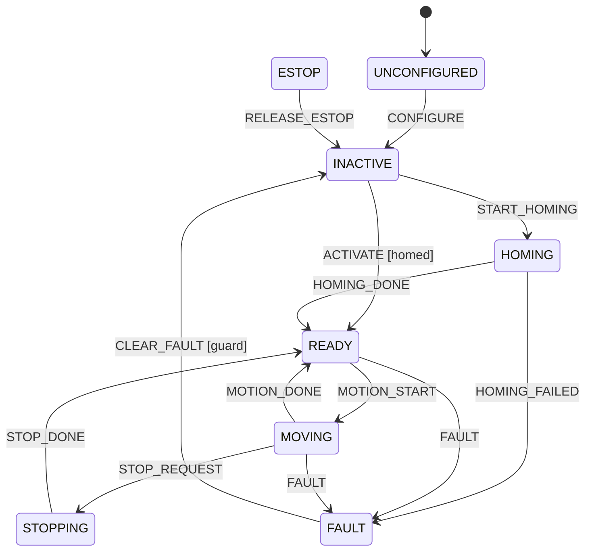

# 13 状态机

> 状态：实现 + 测试（`episode_hardware/state_machine.py`，`tests/test_state_machine.py`）。图：`diagrams/state_machine.mmd`。

（ESTOP 可从任意状态进入；完整转换表见代码 `TRANSITIONS`。）

## 状态规格

| 状态 | 允许事件 | 进入动作 | 退出动作 | 恢复条件 | 安全策略 |
|---|---|---|---|---|---|
| UNCONFIGURED | CONFIGURE, ESTOP | 断开硬件、清缓存 | 加载并校验配置 | 有效配置 + 硬件探测成功 | 任何命令都不到达硬件 |
| INACTIVE | START_HOMING, ACTIVATE[homed], SHUTDOWN, FAULT, ESTOP | 开始轮询；运动禁用 | — | 回零，或在已回零时 ACTIVATE | 只读；运动拒绝 |
| HOMING | HOMING_DONE, HOMING_FAILED, STOP_REQUEST, FAULT, ESTOP | 清 homed、发官方 home、起回零计时（60 s） | 停计时 | 反馈稳定在回零后姿态（±2°）；超时→HOMING_FAILED | 不接受其他运动；机械臂会自行运动 |
| READY | MOTION_START, DEACTIVATE, START_HOMING, STOP_REQUEST(幂等), FAULT, ESTOP | 接受运动 | — | — | 运动需：已回零、反馈新鲜、目标在限位内 |
| MOVING | MOTION_DONE, STOP_REQUEST, FAULT, ESTOP | 启动 TrajectoryMonitor 与超时 | 停 Monitor | 容差内并稳定 → MOTION_DONE；超时/终点误差 → FAULT | 单一运动所有者；新运动按策略拒绝/抢占 |
| STOPPING | STOP_DONE, STOP_REQUEST, FAULT, ESTOP | 软停（不支持则急停），起停止计时 | — | 速度≈0 持续 settle 时间；超时 → 急停 | 不接受新运动 |
| FAULT | CLEAR_FAULT[guard], FAULT, ESTOP | 锁存首个原因；运动中则停止；拒绝运动 | 记录清除人 | 操作员确认 + 反馈新鲜完整 + 连续失败为 0 | 永不自动清除；清除后到 INACTIVE 而非 READY |
| ESTOP | RELEASE_ESTOP, ESTOP | 发急停（专用连接）、取消全部命令、作废回零 | — | 物理原因排除 + 操作员确认（无软件复位能力时需显式确认硬件已复位）；然后重新回零 | 最高优先级；不能替代硬件急停 |

## 设计决定与理由

* **拒绝而不是忽略。** 不允许的事件抛 `StateRejectedError` 并记入历史；静默忽略会掩盖调用方的逻辑错误。
* **FAULT 清除到 INACTIVE。** 故障期间可能发生了未知运动（如反馈丢失时驱动仍在执行），回到 READY 前需要重新确认状态。
* **ESTOP 后作废回零。** 断电/急停期间关节可能被人推动或在重力下滑动；对于以堵转回零建立零点的系统（B），零点有效性无法从软件确认。可配置（`require_rehome_after_estop`），默认保守。
* **保留首个故障原因。** 一连串次生故障（读失败 → 过期 → 超时）中，第一个最接近根因。
* **钩子异常隔离。** 钩子/监听器抛异常只记录日志，状态机继续工作（`test_guards_and_hooks_and_listeners`）。

## 测试覆盖

正常路径、所有状态接受 ESTOP（参数化 8 个）、READY 以外拒绝运动、ACTIVATE 需 homed、FAULT 锁存且保留首因、ESTOP 作废回零且需重新回零、可配置保留回零、回零失败进 FAULT、守卫/钩子/监听器顺序、历史有界。
